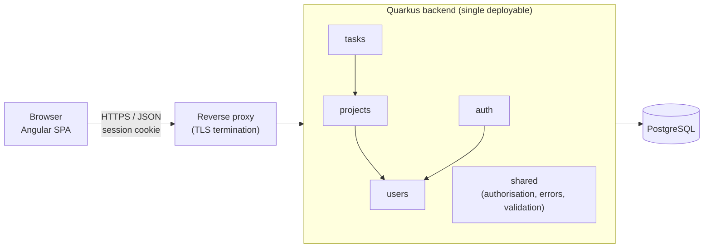

# Matriz — Architecture

> Status: **Draft v0.1 (Class 2)**. Based on [requirements.md](requirements.md), [user-stories.md](user-stories.md) and [constraints.md](constraints.md). Closes pending decisions **D-01** and **D-03**; **D-02** is closed together with [database.md](database.md). Decisions are separated from assumptions (section 6).

## 1. Drivers

| Driver                                                            | Source               |
| ----------------------------------------------------------------- | -------------------- |
| Small scale: ~100 users, ≤ 500 tasks per project, one organisation | A-01, A-08           |
| Web, desktop, UI in Portuguese (Portugal)                         | A-07, NFR-05, NFR-06 |
| Server-side authorisation on every request                        | NFR-03, S-03         |
| Board of 500 tasks in < 2 s                                       | NFR-07               |
| Automated tests for business and permission rules                 | NFR-09               |
| Small team, MVP, no real-time collaboration or notifications      | constraints.md §5    |

## 2. Options considered

| Criterion                    | Monolith                                          | Modular monolith                                         | Microservices                                                 |
| ---------------------------- | ------------------------------------------------- | -------------------------------------------------------- | ------------------------------------------------------------- |
| Fit for MVP scale (A-08)     | Good                                              | Good                                                     | Oversized                                                     |
| Development / deploy effort  | Lowest                                            | Low (one deployable)                                     | High (several services, network, observability, CI per service) |
| Data consistency             | Single DB transaction                             | Single DB transaction                                    | Distributed (e.g. removing a member must unassign tasks in another service) |
| Permission rules (NFR-03)    | Easy, but tends to spread across the code         | Centralised per module, explicit boundaries              | Must be repeated or delegated across services                 |
| Evolution post-MVP           | Risk of "big ball of mud"                         | Modules can later be extracted if ever needed            | Already split, at a high upfront cost                         |
| Testability (NFR-09)         | Good                                              | Good, tests per module                                   | Needs contract/integration tests between services             |

## 3. Decision

**Modular monolith**: a single Quarkus backend exposing a REST API, consumed by an Angular SPA, with a PostgreSQL database.

| ID     | Decision                                                                 | Closes |
| ------ | ------------------------------------------------------------------------ | ------ |
| ADR-01 | Architectural style: modular monolith, REST API + SPA.                    | D-03   |
| ADR-02 | Backend: Java + Quarkus. Frontend: Angular (TypeScript).                  | D-01   |
| ADR-03 | Database: PostgreSQL (relational; data is strongly relational, see [database.md](database.md)). | D-02   |
| ADR-04 | API: REST/JSON, versioned under `/api/v1`, contract in [openapi.yaml](../openapi.yaml). Errors as `application/problem+json` (RFC 9457). | D-03   |
| ADR-05 | Authentication: opaque session token in an `HttpOnly`, `Secure`, `SameSite=Strict` cookie, stored hashed in the database. Allows real logout (US-01 AC5) and immediate revocation on deactivation (S-06, US-02 AC3). | —      |
| ADR-06 | Concurrency: last write wins, no versioning (EC-01).                       | —      |
| ADR-07 | Progress (FR-31) is computed on read with an aggregate query; not stored. | —      |

**Justification:** the MVP has four small, tightly related domains (accounts, projects, members, tasks) sharing one database and needing transactional rules (e.g. EC-02: removing a member unassigns their tasks). Microservices would add distributed consistency and operational cost without any benefit at this scale. A modular monolith keeps the simplicity of a single deployable while enforcing boundaries between modules, which keeps permission rules testable (NFR-09) and allows future extraction if needed.

## 4. Components

### 4.1 Frontend (Angular SPA)

| Area     | Responsibility                                                       | US                |
| -------- | -------------------------------------------------------------------- | ----------------- |
| auth     | Login and logout screens; redirect to login on 401 (EC-07).          | US-01             |
| admin    | Account list, create, deactivate/reactivate (Administrator only).    | US-02             |
| projects | Project list, create/edit project, member management.                | US-03, US-04      |
| board    | Board with 3 status columns, task form, progress indicator, delete.  | US-05 – US-08     |

The SPA only hides actions the user cannot perform; it never enforces permissions (NFR-03). Angular's default output escaping covers EC-08 / S-09.

### 4.2 Backend modules (Quarkus)

| Module   | Responsibility                                                                                      | FR / NFR                         |
| -------- | --------------------------------------------------------------------------------------------------- | -------------------------------- |
| auth     | Login, logout, session validation per request, lockout after 5 failures for 15 min, password hashing. | FR-01, FR-02, NFR-01, NFR-04, S-05, S-06 |
| users    | Account CRUD by the Administrator, activate/deactivate, case-insensitive unique email.              | FR-03, FR-04                     |
| projects | Projects, membership and roles (Manager/Member), visibility rules.                                   | FR-10 – FR-13, EC-04             |
| tasks    | Tasks, status changes, assignee rules, deletion by Manager, progress aggregation.                    | FR-20 – FR-26, FR-30, FR-31      |
| shared   | Authorisation checks (`isMember`, `isManager`, `isAdmin`), input validation, error mapping (404 for unauthorised, EC-05), audit timestamps (NFR-08). | NFR-03, NFR-08, S-03, S-09 |

**Module rules**

- Each module owns its tables; other modules use its public service interface, never its repositories.
- Dependencies point one way: `tasks → projects → users`, `auth → users`. No cycles.
- Every REST endpoint resolves the current user from the session and checks permissions in the module service before any read or write.

### 4.3 Infrastructure

| Component     | Responsibility                                                       |
| ------------- | -------------------------------------------------------------------- |
| Reverse proxy | TLS termination, redirect HTTP → HTTPS (NFR-02), serves SPA static files. |
| PostgreSQL    | Persistence; schema migrations versioned with the code (e.g. Flyway). |
| Configuration | Secrets (DB credentials, etc.) via environment variables only (S-08). |

Hosting remains open (**D-04**).

## 5. Cross-cutting concerns

| Concern        | Approach                                                                                   |
| -------------- | ------------------------------------------------------------------------------------------ |
| Authorisation  | Checked in backend services; non-members get `404` to avoid revealing resources (EC-05).    |
| Validation     | Bean Validation on request DTOs + business checks in services (S-09).                      |
| Error format   | `application/problem+json` with field errors for validation failures.                      |
| Timestamps     | `created_at` / `updated_at` on projects and tasks (NFR-08).                                 |
| Testing        | Unit tests for services/permission rules; `@QuarkusTest` integration tests for the API (NFR-09). |
| Logging        | No passwords, tokens or session IDs in logs (S-08).                                         |
| Performance    | Board loads in one request per project; index on `task(project_id, status)` (NFR-07).       |

## 6. Assumptions and open points

| ID    | Item                                                                                                  | Type        |
| ----- | ----------------------------------------------------------------------------------------------------- | ----------- |
| AA-01 | The Administrator is a normal user with an extra flag; they can also create/join projects (FR-10 says "any active user"). | Assumption  |
| AA-02 | A single deployable is enough for availability needs; no high-availability requirement stated.        | Assumption  |
| AA-03 | Lockout (NFR-04) can be abused to block other users (S-04). Mitigation (e.g. per-IP rate limiting) to be decided. | Pending     |
| AA-04 | Initial password delivery and reset depend on **D-05**; the account-creation API is not specified yet. | Pending     |
| AA-05 | Hosting and deployment (D-04), SSO/2FA (D-06), retention (D-07) and user deletion (D-08) remain open.  | Pending     |

## 7. Consistency review (Exercise 5)

AI-assisted review of requirements ↔ architecture ↔ data ↔ API ↔ wireframe. Each finding was analysed before acting.

| #  | Finding                                                                                                          | Action                                                                                    |
| -- | ---------------------------------------------------------------------------------------------------------------- | ----------------------------------------------------------------------------------------- |
| 1  | EC-01 left the conflict strategy for Class 2.                                                                     | Decided: last write wins (ADR-06). No `version` column.                                    |
| 2  | S-06 requires terminating active sessions; stateless JWT would keep working until expiry.                         | Chose server-side sessions (ADR-05) + `SESSION` table in the data model.                  |
| 3  | Lockout (NFR-04) must not reveal whether an email exists (S-05).                                                  | Login API returns the same `401` for wrong password, unknown email, locked or deactivated account. |
| 4  | FR-24 "assignee must be a project member" — is the Manager a member?                                              | Yes: Manager is stored as a membership with role `MANAGER`, so they can be assignee.       |
| 5  | EC-03 (deactivated assignee keeps tasks) vs EC-02 (removed member's tasks become unassigned).                    | Both kept: deactivation does not touch tasks; member removal unassigns in the same transaction. |
| 6  | Progress with zero tasks (EC-06) would divide by zero.                                                            | API returns `percentDone: null`; UI shows "Sem tarefas".                                   |
| 7  | Suggestion to add filters, comments and "My tasks" to the wireframe.                                             | **Rejected**: post-MVP (FR-32, FR-33) or out of scope.                                     |
| 8  | Suggestion to add `archived` to `PROJECT`.                                                                        | **Rejected for MVP** (FR-14 is S); noted in database.md as post-MVP.                        |
| 9  | Wireframe labels must be in Portuguese (NFR-05) while docs are in English.                                        | Wireframe uses Portuguese labels.                                                          |
| 10 | Lab sheet expects `docs/ui/wireframe.png`.                                                                         | Source kept as [ui/wireframe.svg](ui/wireframe.svg), exported to [ui/wireframe.png](ui/wireframe.png).          |
