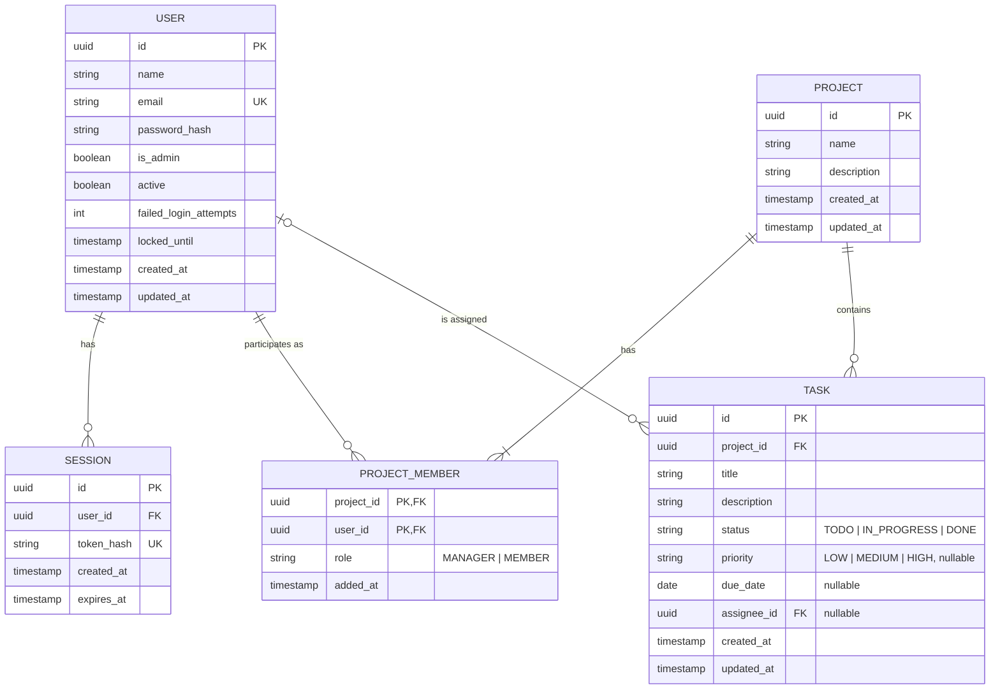

# Matriz — Data Model

> Status: **Draft v0.1 (Class 2)**. Database: PostgreSQL (ADR-03 in [architecture.md](architecture.md)). Covers the MVP only ([requirements.md](requirements.md#5-mvp-scope)).

## 1. Entities

### USER (`app_user`)

| Attribute             | Type         | Rules                                                     | Source        |
| --------------------- | ------------ | --------------------------------------------------------- | ------------- |
| id                    | UUID         | PK                                                        | —             |
| name                  | varchar(100) | Required                                                  | FR-03         |
| email                 | varchar(254) | Required, unique case-insensitive (stored lower-case)     | FR-03, US-02 AC2 |
| password_hash         | varchar(255) | Required; strong salted hash (e.g. Argon2id/bcrypt)       | NFR-01        |
| is_admin              | boolean      | Default `false`                                           | Profiles, AA-01 |
| active                | boolean      | Default `true`                                            | FR-04         |
| failed_login_attempts | integer      | Default 0; reset on successful login                      | NFR-04        |
| locked_until          | timestamptz  | Nullable; login refused while `now() < locked_until`      | NFR-04        |
| created_at            | timestamptz  | Required                                                  | —             |
| updated_at            | timestamptz  | Required                                                  | —             |

### SESSION (`user_session`)

| Attribute   | Type        | Rules                                              | Source       |
| ----------- | ----------- | -------------------------------------------------- | ------------ |
| id          | UUID        | PK                                                 | —            |
| user_id     | UUID        | FK → USER, required                                | —            |
| token_hash  | char(64)    | Unique; hash of the cookie token (never the token) | S-08, ADR-05 |
| created_at  | timestamptz | Required                                           | —            |
| expires_at  | timestamptz | Required                                           | EC-07        |

Deleted on logout (FR-02) and for all of a user's sessions on deactivation (S-06).

### PROJECT (`project`)

| Attribute   | Type         | Rules                                       | Source        |
| ----------- | ------------ | ------------------------------------------- | ------------- |
| id          | UUID         | PK                                          | —             |
| name        | varchar(100) | Required, trimmed, 1–100 chars; not unique  | FR-10, US-03 AC2 |
| description | text         | Optional                                    | FR-10         |
| created_at  | timestamptz  | Required                                    | NFR-08        |
| updated_at  | timestamptz  | Required                                    | NFR-08        |

### PROJECT_MEMBER (`project_member`)

| Attribute  | Type        | Rules                                      | Source        |
| ---------- | ----------- | ------------------------------------------ | ------------- |
| project_id | UUID        | PK (part), FK → PROJECT                    | FR-12         |
| user_id    | UUID        | PK (part), FK → USER                       | FR-12, US-04 AC2 |
| role       | enum        | `MANAGER` \| `MEMBER`                       | A-05          |
| added_at   | timestamptz | Required                                   | —             |

### TASK (`task`)

| Attribute   | Type         | Rules                                                            | Source            |
| ----------- | ------------ | ---------------------------------------------------------------- | ----------------- |
| id          | UUID         | PK                                                               | —                 |
| project_id  | UUID         | FK → PROJECT, required                                           | FR-20             |
| title       | varchar(200) | Required, trimmed, 1–200 chars; stored as plain text             | FR-20, US-05 AC2, EC-08 |
| description | text         | Optional                                                         | FR-20             |
| status      | enum         | `TODO` \| `IN_PROGRESS` \| `DONE`; default `TODO`                 | FR-22             |
| priority    | enum         | Nullable; `LOW` \| `MEDIUM` \| `HIGH`                              | FR-26             |
| due_date    | date         | Nullable; past dates allowed                                     | US-05 AC4, EC-09  |
| assignee_id | UUID         | Nullable, FK → USER; must be a member of the task's project      | FR-24             |
| created_at  | timestamptz  | Required                                                         | NFR-08            |
| updated_at  | timestamptz  | Required; updated on every change (incl. status)                 | NFR-08, US-06 AC1 |

## 2. Relationships and cardinalities

| Relationship                 | Cardinality | Notes                                                    |
| ---------------------------- | ----------- | -------------------------------------------------------- |
| USER – SESSION               | 1 : 0..N    | A user may have several active sessions.                 |
| USER – PROJECT_MEMBER        | 1 : 0..N    | A user may belong to many projects.                      |
| PROJECT – PROJECT_MEMBER     | 1 : 1..N    | At least the Manager; exactly one `MANAGER` per project. |
| PROJECT – TASK               | 1 : 0..N    | Tasks are deleted with the project (no project deletion in MVP). |
| USER – TASK (assignee)       | 0..1 : 0..N | A task has at most one assignee.                         |

## 3. ER diagram

## 4. Business rules and constraints

| ID    | Rule                                                                                         | Enforced by                                        | Source       |
| ----- | -------------------------------------------------------------------------------------------- | -------------------------------------------------- | ------------ |
| BR-01 | Email unique ignoring case.                                                                  | Unique index on `lower(email)`                     | US-02 AC2    |
| BR-02 | Exactly one Manager per project.                                                             | Partial unique index `(project_id) WHERE role = 'MANAGER'` + service | A-05, EC-04 |
| BR-03 | The project creator becomes its Manager.                                                     | Service (same transaction as project insert)       | FR-10        |
| BR-04 | The Manager cannot be removed from the project.                                              | Service                                            | US-04 AC4    |
| BR-05 | Assignee must be a member of the task's project.                                             | Service                                            | FR-24        |
| BR-06 | Removing a member sets `assignee_id = NULL` on their tasks in that project.                  | Service (same transaction)                         | EC-02        |
| BR-07 | Deactivating a user keeps their task assignments and deletes their sessions.                 | Service                                            | EC-03, S-06  |
| BR-08 | Only the Manager can delete tasks (hard delete).                                              | Service                                            | FR-25        |
| BR-09 | Progress = round(100 × DONE / total); `null` when total = 0.                                  | Aggregate query                                    | FR-31, EC-06 |
| BR-10 | Users are never physically deleted in the MVP (only deactivated).                            | No delete operation                                | FR-04, D-08  |

**Indexes:** `task(project_id, status)` for the board and progress (NFR-07); `task(assignee_id)`; `project_member(user_id)` for "my projects" (FR-13).

## 5. Assumptions and pending items

| ID    | Item                                                                                       | Type       |
| ----- | ------------------------------------------------------------------------------------------ | ---------- |
| DA-01 | UUIDs as identifiers, so IDs in URLs are not guessable (complements EC-05).                | Decision   |
| DA-02 | No `archived` flag on PROJECT in the MVP; will be added with FR-14 (post-MVP).             | Decision   |
| DA-03 | No task history/audit log beyond `created_at` / `updated_at`.                              | Assumption |
| DA-04 | Retention of data of deactivated users (D-07) and user deletion (D-08).                    | Pending    |
| DA-05 | Storage of temporary/initial passwords depends on D-05.                                     | Pending    |
