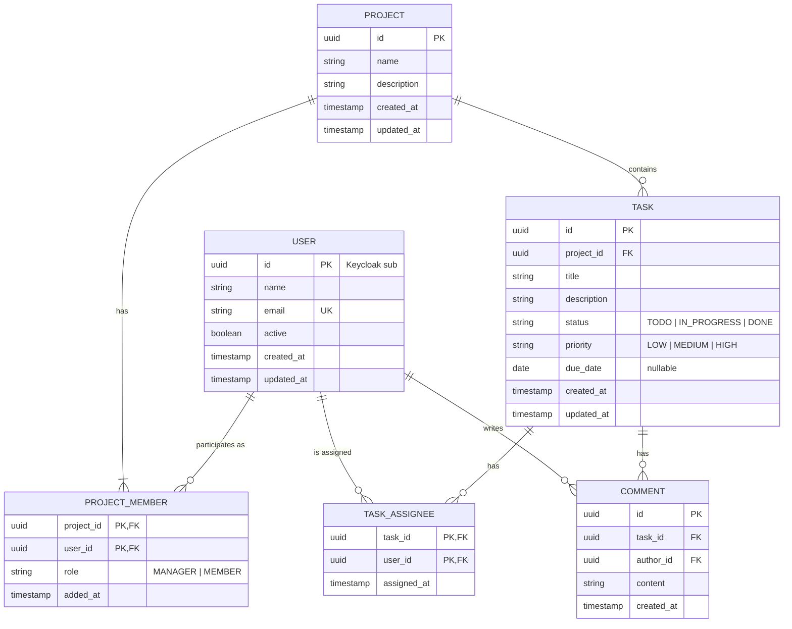

# Matriz — Data Model

> Status: **v0.2 (Class 3)**. Database: PostgreSQL (ADR-03 in [architecture.md](architecture.md)). Covers the MVP ([requirements.md](requirements.md#5-mvp-scope)). Class 3 changes: several assignees per task (`TASK_ASSIGNEE`), comments (`COMMENT`), project deletion and new field limits.

## 1. Entities

### USER (`app_user`)

Local projection of the Keycloak user (ADR-09). Credentials, roles and sessions live only in Keycloak.

| Attribute  | Type         | Rules                                                         | Source           |
| ---------- | ------------ | ------------------------------------------------------------- | ---------------- |
| id         | UUID         | PK; equals the Keycloak user id (`sub` claim)                 | ADR-09           |
| name       | varchar(255) | Required; first + last name from Keycloak                     | FR-03            |
| email      | varchar(254) | Required; unique case-insensitive (also enforced by Keycloak) | FR-03, US-02 AC2 |
| active     | boolean      | Mirrors Keycloak `enabled`; updated by the sync               | FR-04, EC-03     |
| created_at | timestamptz  | Required                                                      | —                |
| updated_at | timestamptz  | Required; last sync change                                    | —                |

### PROJECT (`project`)

| Attribute   | Type          | Rules                                      | Source           |
| ----------- | ------------- | ------------------------------------------ | ---------------- |
| id          | UUID          | PK                                         | —                |
| name        | varchar(100)  | Required, trimmed, 3–100 chars; not unique | FR-10, US-03 AC2 |
| description | varchar(1000) | Optional, up to 1000 chars                 | FR-10            |
| created_at  | timestamptz   | Required                                   | NFR-08           |
| updated_at  | timestamptz   | Required                                   | NFR-08           |

### PROJECT_MEMBER (`project_member`)

| Attribute  | Type        | Rules                   | Source           |
| ---------- | ----------- | ----------------------- | ---------------- |
| project_id | UUID        | PK (part), FK → PROJECT | FR-12            |
| user_id    | UUID        | PK (part), FK → USER    | FR-12, US-04 AC2 |
| role       | enum        | `MANAGER` \| `MEMBER`   | A-05             |
| added_at   | timestamptz | Required                | —                |

### TASK (`task`)

| Attribute   | Type          | Rules                                                   | Source                  |
| ----------- | ------------- | ------------------------------------------------------- | ----------------------- |
| id          | UUID          | PK                                                      | —                       |
| project_id  | UUID          | FK → PROJECT, required                                  | FR-20                   |
| title       | varchar(150)  | Required, trimmed, 3–150 chars; stored as plain text    | FR-20, US-05 AC2, EC-08 |
| description | varchar(2000) | Optional, up to 2000 chars                              | FR-20                   |
| status      | enum          | `TODO` \| `IN_PROGRESS` \| `DONE`; default `TODO`       | FR-22                   |
| priority    | enum          | `LOW` \| `MEDIUM` \| `HIGH`; required, default `MEDIUM` | FR-26                   |
| due_date    | date          | Nullable; past dates allowed                            | US-05 AC4, EC-09        |
| created_at  | timestamptz   | Required                                                | NFR-08                  |
| updated_at  | timestamptz   | Required; updated on every change (incl. status)        | NFR-08, US-06 AC1       |

### TASK_ASSIGNEE (`task_assignee`)

| Attribute   | Type        | Rules                                   | Source |
| ----------- | ----------- | --------------------------------------- | ------ |
| task_id     | UUID        | PK (part), FK → TASK, cascade on delete | FR-24  |
| user_id     | UUID        | PK (part), FK → USER                    | FR-24  |
| assigned_at | timestamptz | Required, set by the backend            | —      |

### COMMENT (`task_comment`)

| Attribute  | Type          | Rules                                         | Source       |
| ---------- | ------------- | --------------------------------------------- | ------------ |
| id         | UUID          | PK                                            | —            |
| task_id    | UUID          | FK → TASK, required, cascade on delete        | FR-27        |
| author_id  | UUID          | FK → USER, required; from the token           | FR-27        |
| content    | varchar(2000) | Required, 1–2000 chars, not blank; plain text | FR-27, EC-08 |
| created_at | timestamptz   | Required, set by the backend                  | FR-27        |

## 2. Relationships and cardinalities

| Relationship             | Cardinality | Notes                                                    |
| ------------------------ | ----------- | -------------------------------------------------------- |
| USER – PROJECT_MEMBER    | 1 : 0..N    | A user may belong to many projects.                      |
| PROJECT – PROJECT_MEMBER | 1 : 1..N    | At least the Manager; exactly one `MANAGER` per project. |
| PROJECT – TASK           | 1 : 0..N    | Tasks are deleted with the project (FR-15).              |
| TASK – TASK_ASSIGNEE     | 1 : 0..N    | A task can have several assignees (FR-24).               |
| USER – TASK_ASSIGNEE     | 1 : 0..N    | A user can be assigned to many tasks.                    |
| TASK – COMMENT           | 1 : 0..N    | Comments are deleted with the task.                      |
| USER – COMMENT (author)  | 1 : 0..N    | Each comment has exactly one author.                     |

## 3. ER diagram

## 4. Business rules and constraints

| ID    | Rule                                                                                                          | Enforced by                                                          | Source       |
| ----- | ------------------------------------------------------------------------------------------------------------- | -------------------------------------------------------------------- | ------------ |
| BR-01 | Email unique ignoring case.                                                                                   | Unique index on `lower(email)`                                       | US-02 AC2    |
| BR-02 | Exactly one Manager per project.                                                                              | Partial unique index `(project_id) WHERE role = 'MANAGER'` + service | A-05, EC-04  |
| BR-03 | The project creator becomes its Manager.                                                                      | Service (same transaction as project insert)                         | FR-10        |
| BR-04 | The Manager cannot be removed from the project.                                                               | Service                                                              | US-04 AC4    |
| BR-05 | An assignee must be an active member of the task's project; the same user cannot be assigned twice to a task. | Service + composite PK                                               | FR-24        |
| BR-06 | Removing a member deletes their `TASK_ASSIGNEE` rows for tasks of that project.                               | Service (same transaction)                                           | EC-02        |
| BR-07 | Deactivating a user (in Keycloak) keeps their task assignments; the sync sets `active = false`.                | Keycloak + sync job                                                  | EC-03, S-06  |
| BR-08 | Only the Manager can delete tasks (hard delete; assignments and comments cascade).                            | Service + `ON DELETE CASCADE`                                        | FR-25        |
| BR-09 | Progress = round(100 × DONE / total); `null` when total = 0.                                                  | Aggregate query                                                      | FR-31, EC-06 |
| BR-10 | Local users are never physically deleted; a user deleted in Keycloak is marked `active = false` by the sync.   | Sync job                                                             | FR-04, D-08  |
| BR-11 | Only the Manager can delete a project; members, tasks, assignments and comments are deleted with it.          | Service + `ON DELETE CASCADE`                                        | FR-15        |
| BR-12 | Comment author and date are set from the authenticated user (token), never from the request.                  | Service                                                              | FR-27        |

**Indexes:** `task(project_id, status)` for the board and progress (NFR-07); `task_assignee(user_id)`; `task_comment(task_id, created_at)`; `project_member(user_id)` for "my projects" (FR-13); `lower(project.name)` search uses `ILIKE` (small volume, no index needed).

## 5. Assumptions and pending items

| ID    | Item                                                                           | Type       |
| ----- | ------------------------------------------------------------------------------ | ---------- |
| DA-01 | UUIDs as identifiers, so IDs in URLs are not guessable (complements EC-05).    | Decision   |
| DA-02 | No `archived` flag on PROJECT in the MVP; will be added with FR-14 (post-MVP). | Decision   |
| DA-03 | No task history/audit log beyond `created_at` / `updated_at`.                  | Assumption |
| DA-04 | Retention of data of deactivated users (D-07) and user deletion (D-08).        | Pending    |
| DA-05 | Passwords are never stored by the application; Keycloak owns them (ADR-08).    | Decision   |
