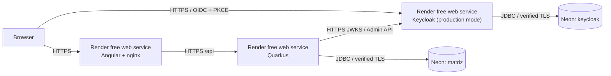

# Matriz — Render + Neon deployment

This is the approved D-04 topology for an academic demonstration, not an always-on production SLA. Ficha 5's reproducible Docker builds, Compose, CI, release notes and verification remain applicable; Render adds public HTTPS hosting. No cloud resources have been created by these instructions.

## 1. Topology and cost limits



All three Render services use `plan: free` in [render.yaml](../render.yaml), in Frankfurt. Free web services cannot receive private-network requests, so **use their public HTTPS origins**, not internal Render hostnames. nginx proxies `/api` on the frontend's origin; no cross-origin API configuration is needed.

At preparation time, [Render Free](https://render.com/docs/free) provides 750 running instance-hours/month **shared across the workspace**, 512 MB per web service and idle spin-down after 15 minutes. Three continuously running services exceed that allowance. The backend's scheduled user sync calls Keycloak every five minutes while the backend is awake, so those two services can stay awake together. Do not add keep-alive pings. Cold starts can interrupt the first login/API request; open Keycloak, then the backend health endpoint, then the frontend before presenting. Java heaps and database pools are bounded, but actual Render memory use/startup must still be verified.

[Neon Free](https://neon.com/pricing) is not a time-limited trial, but has storage, compute and transfer limits and scales to zero. Keycloak background database work and the backend sync may prevent Neon from sleeping, so watch compute consumption. Render's free Postgres instead expires after 30 days: it is not used here. Check current provider quotas before deploying; choose Free explicitly, do not enable paid upgrades, and review billing/spend controls before adding payment details. This configuration cannot guarantee perpetual free availability.

## 2. Create the databases in Neon

1. In your own Neon account, create a **Free** project near Frankfurt. Use a PostgreSQL version supported by the pinned Keycloak release (PostgreSQL 18 matches local development).
2. Create databases `matriz` and `keycloak`, with **different owner roles and generated passwords**. Keep passwords in provider dashboards or a password manager, never in Git, screenshots, logs or chat. Use only fictitious presentation data.
3. Use **direct/unpooled** connection hosts (not hosts containing `-pooler`). Flyway and Keycloak perform schema migrations; do not put a transaction-pooling endpoint in front of them. Do not share either database with local development or automated tests.
4. From Neon's Connect dialog, record each database's host, name, role and password privately. Construct these JDBC URLs **without credentials in the URL**:

   ```text
   jdbc:postgresql://<direct-neon-host>:5432/matriz?sslmode=verify-full&sslfactory=org.postgresql.ssl.DefaultJavaSSLFactory
   jdbc:postgresql://<direct-neon-host>:5432/keycloak?sslmode=verify-full&sslfactory=org.postgresql.ssl.DefaultJavaSSLFactory
   ```

`verify-full` checks the database hostname; `DefaultJavaSSLFactory` uses Java's trusted public CAs rather than requiring pgJDBC's default local `~/.postgresql/root.crt`. Keep both parameters. PostgreSQL credentials are supplied separately. The application applies Flyway migrations automatically; Keycloak owns and migrates its own database. The application starts **empty**, without the dev seed.

## 3. Publish and create the Render Blueprint

Commit/push the approved changes to GitHub yourself, or separately authorise those operations. In Render, choose **New → Blueprint**, connect `PHGil/matriz`, choose the branch containing `render.yaml`, and review the plan for all three services before applying it. No paid databases or disks are declared.

The Blueprint prompts for these values (`sync: false`). Enter secrets directly in Render:

| Service | Variable | Value |
| --- | --- | --- |
| Keycloak | `KC_HOSTNAME` | Its public `https://…onrender.com` origin, no trailing slash |
| Keycloak | `MATRIZ_FRONTEND_URL` | Frontend public `https://…onrender.com` origin, no trailing slash |
| Keycloak | `KC_DB_URL` | Full JDBC URL for the **keycloak** database above |
| Keycloak | `KC_DB_USERNAME`, `KC_DB_PASSWORD` | Keycloak database's owner role and password |
| Keycloak | `KC_BOOTSTRAP_ADMIN_USERNAME`, `KC_BOOTSTRAP_ADMIN_PASSWORD` | Choose a bootstrap administrator and a strong unique password |
| Backend | `DB_JDBC_URL` | Full JDBC URL for the **matriz** database above |
| Backend | `DB_USER`, `DB_PASSWORD` | Application database's owner role and password |
| Frontend | `BACKEND_URL` | Backend public `https://…onrender.com` origin, no trailing slash |

Render chooses unique public subdomains; **do not assume they equal the service names**. If the Blueprint form requires origins before URLs are assigned, enter provisional HTTPS origins and expect the first deployment to be incomplete. Once resources appear, copy their actual URLs from their dashboards and correct the three origin variables above before using the app. Redeploy in this order:

1. **Keycloak:** correct `KC_HOSTNAME` and `MATRIZ_FRONTEND_URL`, then deploy. Wait for `/realms/matriz/.well-known/openid-configuration` to return JSON whose `issuer` is exactly `<KC_HOSTNAME>/realms/matriz`.
2. **Backend:** verify its referenced `KEYCLOAK_URL` matches the corrected Keycloak origin; deploy and wait for `/q/health/ready` to return `UP`.
3. **Frontend:** correct `BACKEND_URL`, verify its referenced `KEYCLOAK_URL`, deploy and open `/config.js`; it must contain the public HTTPS Keycloak origin, not localhost.

The Blueprint generates `MATRIZ_BACKEND_CLIENT_SECRET` on Keycloak and references the **same value** on the backend. It also references `KC_HOSTNAME` for the backend and frontend `KEYCLOAK_URL`. After changing a referenced value, verify/redeploy the consumers; do not assume an already running container has updated.

Render terminates TLS and forwards requests over HTTP inside each service. Keycloak uses `start --optimized`, `KC_PROXY_HEADERS=xforwarded`, HTTP port 10000 and local single-instance caching; application/Keycloak persistence is in Neon, not the ephemeral container filesystem. Keycloak's management port 9000 is **not** the public health endpoint. Backend and frontend bind 8080 and 80 respectively; the Blueprint sets `PORT` to match.

Automatic deployment uses `checksPass` so subsequent GitHub deployments wait for checks, including CI's image builds. The first deployment is not evidence that CI ran: inspect GitHub Actions separately. No deploy hooks or additional tokens are required.

## 4. Configure accounts and verify login

Open `<KC_HOSTNAME>/admin/` and log in with the bootstrap administrator in the **master** realm. Create a permanent administrator following Keycloak's console guidance, verify it works, then remove the temporary bootstrap administrator through the console and remove its bootstrap variables from Render. Creating/changing bootstrap environment variables does **not** reset an existing administrator's password.

The imported `matriz` realm has the frontend and backend clients and the `view-users` service account only. It deliberately contains **no demo accounts, shared demo password, or password-grant test client**. In the console select `matriz` and create presentation users with fictitious names/emails and unique passwords. A realm account administrator needs `realm-management` → `realm-admin`; this does not grant application project access (A-03). Other users do not need realm administration roles.

Allow up to five minutes for user projection sync before adding users as project members. Each user's own login also creates/updates their projection. Use the UI to create a project, add another user, and create sample tasks/comments; the local dev seed is intentionally not imported.

**Important: realm import is first-start only.** If the realm already exists in Neon, a new image or changed import variables will **not** overwrite it:

- If the frontend URL changes, edit `matriz-frontend` in the console: Root URL = frontend origin, Valid redirect URIs = `<origin>/*`, Web origins = exact origin, Valid post logout redirect URIs = `<origin>/*`. Keep PKCE S256.
- If the backend client secret must change, rotate it in the console, update the Keycloak service's `MATRIZ_BACKEND_CLIENT_SECRET` in Render to match, then redeploy the backend with the updated reference.
- Do not delete the realm/database to apply a configuration change: that would lose users and break `sub` references in application data.

## 5. Presentation and Ficha 5 evidence

Run these checks against the actual cloud deployment and record date, result and evidence in [verification.md](verification.md). Never capture credentials or tokens.

| Check | Expected |
| --- | --- |
| Public frontend, API health and OIDC discovery URLs | HTTPS with valid certificates; HTTP redirects to HTTPS |
| OIDC discovery | Issuer and all browser-facing endpoints use the public Keycloak HTTPS origin |
| Frontend `/config.js`, browser Network tab | Correct Keycloak origin, no localhost, no mixed content |
| `/api/v1/projects` through frontend, without a token | `401`, not the SPA HTML or a successful list |
| Login, logout, wrong password, disabled account | US-01 / US-02; logout returns to login, protected pages require a session |
| Two users and a non-member | Membership restrictions, outsider cannot read the project (US-03 / US-04) |
| Project, task, status, assignees, comment, progress | Existing MVP behaviour; changes visible after reload |
| Manually redeploy backend, frontend and Keycloak | Accounts and project/task data persist in Neon; verify login again |
| Render logs, Metrics and Neon usage | No unresolved errors/OOM; record cold-start and memory limits |
| GitHub Actions | Required checks pass before automatic deployments |

Troubleshooting:

- **Invalid redirect URI:** check the actual frontend URL and the persisted client's redirect/logout settings, not just import environment variables.
- **Issuer mismatch or HTTP endpoints:** check `KC_HOSTNAME`, proxy headers and discovery; use the same public Keycloak origin in browser and backend.
- **502 / loading page / failed first login:** wake Keycloak, wait for backend readiness, then reload the frontend; check service logs for startup errors.
- **JDBC TLS errors:** use the direct Neon hostname, both TLS URL parameters and the correct database role/password. Do not disable certificate checks.
- **User sync warning / user picker empty:** check the persisted `matriz-backend` secret and service account's `view-users` role; wait for sync.
- **Out of memory / quota exhausted:** inspect metrics and provider limits. Do not silently switch to a paid plan. Pause unused services or review hosting with the project owner.

## 6. Local regression checks

Local Compose and development commands remain in [README.md](../README.md). Frontend containers default to local Keycloak unless `KEYCLOAK_URL` is set; nginx writes `/config.js` on each startup and serves it with `Cache-Control: no-store`. Only HTTP(S) origins without a trailing slash are accepted.

```bash
node --test keycloak/production-realm.test.mjs
docker compose --env-file .env.example --profile app config -q
docker build -t matriz-keycloak:check keycloak
```

The backend's optional `DB_JDBC_URL` overrides the assembled host/port/name URL for dev/prod; the isolated `st` database remains unchanged. Do **not** run the system/E2E suites against the cloud database: those suites truncate data. Local Compose still uses the local realm with its fictitious demo accounts, while Render builds the separate production image.
